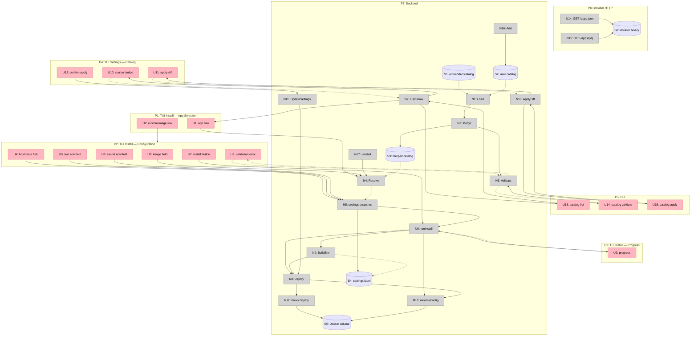

# App Catalog — Shaping

Status: shape selected, breadboarded, ready to slice
Selected shape: **A — Local-first single-file manifests**
Related: [`slices.md`](slices.md) · [`../oma-fork-plan.md`](../oma-fork-plan.md)

## Frame

### Source

Oma needs an easy way to add any compatible app to the installer without rebuilding or releasing the binary. Users should be able to extend the catalog locally, then deploy apps to their own machine, another home computer, or a cloud VPS. Most expected apps are Rails backends serving mobile and Hotwire Native clients.

### Problem

- The app list is hardcoded in `internal/ui/install_app_list.go`.
- The deploy contract is hardcoded: port 80, `/up`, one volume, Rails-oriented env.
- Adding an app requires a code change and a release.
- Arbitrary images already install, but users must know the image and cannot declare defaults, health checks, ports, or required environment.

### Outcome

- A user can add or update one app by writing one manifest file.
- The app list, installer, CLI, and deploy engine read the same catalog.
- Catalog defaults produce a working install without hand-editing settings.
- Changing a manifest does not silently change an installed app.
- Existing apps and image-based installs keep working.

## Requirements

| ID | Requirement | Status |
| --- | --- | --- |
| R0 | Add or update an app manifest without changing or releasing the Oma binary | Core goal |
| R1 | Install any compliant single-container web app; built-in apps keep working | Core goal |
| R2 | Catalog works from embedded built-ins and a local user directory with no network dependency | Must-have |
| R3 | Merge by `id`; a user entry replaces the embedded entry as a whole; ordering is deterministic | Must-have |
| R4 | Adding or editing one app touches exactly one manifest file | Must-have |
| R5 | Manifest declares `schemaVersion`, `kind`, `id`, name, description, category, image, and suggested hostname | Must-have |
| R6 | Validation rejects invalid IDs, image references, ports, paths, env names, schema versions, and unsupported kinds with actionable errors | Must-have |
| R7 | Manifest declares container HTTP port, health path, health port, and health timeout; proxy and verification use them | Must-have |
| R8 | Manifest declares one named volume and multiple mount targets; backup uses the primary target | Must-have |
| R9 | Manifest declares TLS mode and an HTTP verification toggle | Must-have |
| R10 | Manifest declares env values: required, default, generated, secret, and system-derived | Must-have |
| R11 | Install resolves user catalog, embedded catalog, alias, then raw image | Must-have |
| R12 | Install snapshots resolved values into `ApplicationSettings`; no live re-resolution | Must-have |
| R13 | `catalog apply` previews a diff and applies a defined subset; env and secrets are not overwritten | Must-have |
| R14 | Existing settings labels, image installs, backups, and aliases keep working | Must-have |
| R15 | Installer serves embedded `/apps.json` and `/apps/{id}`; raw image routes unchanged | Must-have |
| R16 | CLI provides catalog `list`, `show`, `validate`, `add`, and `apply` | Should-have |
| R17 | App list shows name, description, category, and source | Should-have |
| R18 | Older binaries reject newer `schemaVersion` values and unsupported kinds | Should-have |
| R19 | Secret env values are masked in the UI and CLI and stored only in app settings | Should-have |
| R20 | `disabled: true` can hide a built-in entry | Nice-to-have |
| R21 | Remote catalog URLs and signing are out of scope | Out |
| R22 | Worker and multi-container app kinds are out of scope | Out |
| R23 | Multiple named volumes are out of scope | Out |
| R24 | Automatic redeploy when a catalog entry changes is out of scope | Out |
| R25 | Manifests never create host bind mounts | Must-have |
| R26 | Installer cannot read a user's local catalog; local apps cannot produce hosted install URLs | Must-have |
| R27 | Old backup archives remain readable; new settings fields are optional | Must-have |

Out-of-scope rows are not scored in the fit check.

## Shapes

### A: Local-first single-file manifests (selected)

One manifest per app. Built-ins are embedded; users add or replace manifests in a local directory. The binary loads, validates, and merges them in memory.

| Part | Mechanism |
| --- | --- |
| **A1** | `internal/catalog` schema, parsing, and validation |
| **A2** | Embedded `apps/*.yaml` via `go:embed` |
| **A3** | User loader for `$XDG_CONFIG_HOME/oma/apps` or `~/.config/oma/apps` |
| **A4** | Merge and resolve: whole-entry replacement by `id`, deterministic order, user before embedded |
| **A5** | Install-time snapshot into `ApplicationSettings` |
| **A6** | Deploy mapping: service port, health, mount targets, TLS, verification, command/user |
| **A7** | Env resolution and install-time form |
| **A8** | `catalog apply` diff, preview, and explicit update |
| **A9** | Installer `/apps.json` and `/apps/{id}` from embedded data |
| **A10** | Catalog CLI and UI surfaces |

### B: Central catalog index

All apps live in one index file; user overrides replace entries in that index.

| Part | Mechanism |
| --- | --- |
| **B1** | One `catalog.yaml` containing every app |
| **B2** | Embedded index plus a user index override |
| **B3** | Entry-level merge keyed by `id` |
| **B4** | Same deploy and env mapping as A |

### C: Layered manifests with field-level patches

A base manifest plus environment or deployment overlays, merged field by field.

| Part | Mechanism |
| --- | --- |
| **C1** | Base app manifest |
| **C2** | Overlay files with field-level patches |
| **C3** | Ordered patch application and precedence rules |
| **C4** | Same deploy and env mapping as A |

### D: Remote registry with local cache

Apps are published to a hosted registry; clients fetch and cache them.

| Part | Mechanism |
| --- | --- |
| **D1** | Remote catalog service |
| **D2** | Client fetch, cache, and ETag handling |
| **D3** | Registry authentication and trust policy |
| **D4** | Same deploy and env mapping as A |

## Fit Check

| Req | Requirement | Status | A | B | C | D |
| --- | --- | --- | --- | --- | --- | --- |
| R0 | Add or update an app manifest without changing or releasing the Oma binary | Core goal | ✅ | ✅ | ✅ | ✅ |
| R1 | Install any compliant single-container web app; built-in apps keep working | Core goal | ✅ | ✅ | ✅ | ✅ |
| R2 | Catalog works from embedded built-ins and a local user directory with no network dependency | Must-have | ✅ | ✅ | ✅ | ❌ |
| R3 | Merge by `id`; a user entry replaces the embedded entry as a whole; ordering is deterministic | Must-have | ✅ | ✅ | ❌ | ✅ |
| R4 | Adding or editing one app touches exactly one manifest file | Must-have | ✅ | ❌ | ❌ | ❌ |
| R5 | Manifest declares `schemaVersion`, `kind`, `id`, name, description, category, image, and suggested hostname | Must-have | ✅ | ✅ | ✅ | ✅ |
| R6 | Validation rejects invalid IDs, image references, ports, paths, env names, schema versions, and unsupported kinds with actionable errors | Must-have | ✅ | ✅ | ✅ | ✅ |
| R7 | Manifest declares container HTTP port, health path, health port, and health timeout; proxy and verification use them | Must-have | ✅ | ✅ | ✅ | ✅ |
| R8 | Manifest declares one named volume and multiple mount targets; backup uses the primary target | Must-have | ✅ | ✅ | ✅ | ✅ |
| R9 | Manifest declares TLS mode and an HTTP verification toggle | Must-have | ✅ | ✅ | ✅ | ✅ |
| R10 | Manifest declares env values: required, default, generated, secret, and system-derived | Must-have | ✅ | ✅ | ✅ | ✅ |
| R11 | Install resolves user catalog, embedded catalog, alias, then raw image | Must-have | ✅ | ✅ | ✅ | ✅ |
| R12 | Install snapshots resolved values into `ApplicationSettings`; no live re-resolution | Must-have | ✅ | ✅ | ✅ | ✅ |
| R13 | `catalog apply` previews a diff and applies a defined subset; env and secrets are not overwritten | Must-have | ✅ | ✅ | ✅ | ✅ |
| R14 | Existing settings labels, image installs, backups, and aliases keep working | Must-have | ✅ | ✅ | ✅ | ✅ |
| R15 | Installer serves embedded `/apps.json` and `/apps/{id}`; raw image routes unchanged | Must-have | ✅ | ✅ | ✅ | ❌ |
| R16 | CLI provides catalog `list`, `show`, `validate`, `add`, and `apply` | Should-have | ✅ | ✅ | ✅ | ✅ |
| R17 | App list shows name, description, category, and source | Should-have | ✅ | ✅ | ✅ | ✅ |
| R18 | Older binaries reject newer `schemaVersion` values and unsupported kinds | Should-have | ✅ | ✅ | ✅ | ✅ |
| R19 | Secret env values are masked in the UI and CLI and stored only in app settings | Should-have | ✅ | ✅ | ✅ | ✅ |
| R20 | `disabled: true` can hide a built-in entry | Nice-to-have | ✅ | ✅ | ✅ | ✅ |
| R25 | Manifests never create host bind mounts | Must-have | ✅ | ✅ | ✅ | ✅ |
| R26 | Installer cannot read a user's local catalog; local apps cannot produce hosted install URLs | Must-have | ✅ | ✅ | ✅ | ❌ |
| R27 | Old backup archives remain readable; new settings fields are optional | Must-have | ✅ | ✅ | ✅ | ✅ |

**Notes**

- B fails R4: every app change edits the central index, creating merge conflicts and coupling unrelated apps.
- C fails R3 and R4: one app is spread across a base and overlays, so replacement and apply semantics are ambiguous.
- D fails R2, R4, R15, and R26: it requires a network service, publication is remote, installer data and user data diverge, and local apps cannot participate.

Shape A is selected because it passes every Core and Must-have requirement and keeps each app independently editable.

## Selected Shape: A

### Resolved component decisions

| Decision | Selected behavior |
| --- | --- |
| Env form depth | Text and secret fields, optional default, required marker, generated values. Typed number/boolean/select fields are deferred. |
| `catalog apply` UX | Show a field diff, require confirmation or `--yes`, apply a defined subset, never overwrite env or secrets by default. |
| Override/disable | Whole-entry replacement by `id`; support `disabled: true` to hide a built-in. |
| Schema policy | `schemaVersion` is required. Reject newer versions and unknown kinds. |
| Image version policy | Allow tags or digests. Auto-update applies only to tag-based images. |
| Multi-volume | One named volume, multiple mount targets. Multiple volume names fail validation. |
| App kinds | `kind: web` only. Workers and stacks are future `schemaVersion` work. |

### Parts

| Part | Mechanism | Flag |
| --- | --- | :---: |
| **A1** | `internal/catalog` types, parser, validator, schema version, kind | |
| **A2** | Embedded `apps/*.yaml` loaded with `go:embed` | |
| **A3** | User catalog loader rooted at `$XDG_CONFIG_HOME/oma/apps` | |
| **A4** | Whole-entry merge by `id`, disabled-entry filtering, deterministic order | |
| **A5** | Resolver for ID, alias, and raw image; install snapshot into settings | |
| **A6** | Deploy mapping for port, health, mounts, TLS, verification, command, user | |
| **A7** | Env model: required, default, generated, secret, system-derived; install form | |
| **A8** | Apply diff over an allowed field subset; confirmation; settings update | |
| **A9** | Installer JSON and per-app routes from embedded data | |
| **A10** | CLI commands and TUI app-list metadata/source | |

No flagged unknowns remain for the selected shape.

## Breadboard

### Places

| # | Place | Description |
| --- | --- | --- |
| P1 | TUI: Install — App Selection | Choose a catalog app or custom image |
| P2 | TUI: Install — Configuration | Hostname, env, and install action |
| P3 | TUI: Install — Progress | Pull, start, verify |
| P4 | TUI: Settings — Catalog | Source and apply preview |
| P5 | CLI | Catalog commands and install flags |
| P6 | Installer HTTP | Embedded catalog and install script routes |
| P7 | Backend | Catalog loading, settings, Docker operations |

### UI Affordances

| # | Place | Component | Affordance | Control | Wires Out | Returns To |
| --- | --- | --- | --- | --- | --- | --- |
| U1 | P1 | InstallAppList | App row with name, description, category, source | click | → N4 | — |
| U2 | P1 | InstallAppList | Custom Docker image row | click | → P2 | — |
| U3 | P2 | InstallImageForm | Image field | type | → N4 | — |
| U4 | P2 | InstallHostnameForm | Hostname field | type | → N5 | — |
| U5 | P2 | InstallEnvForm | Text env field | type | → N5 | — |
| U6 | P2 | InstallEnvForm | Secret env field | type | → N5 | — |
| U7 | P2 | InstallEnvForm | Install button | click | → N6 | — |
| U8 | P2 | InstallEnvForm | Validation error banner | render | — | — |
| U9 | P3 | InstallActivity | Progress stage and percentage | render | — | — |
| U10 | P4 | SettingsMenu | Catalog source badge | render | — | — |
| U11 | P4 | CatalogApply | Field diff preview | render | — | — |
| U12 | P4 | CatalogApply | Confirm apply | click | → N11 | — |
| U13 | P5 | `oma catalog list` | Catalog table | invoke | → N7 | — |
| U14 | P5 | `oma catalog validate` | Validation report | invoke | → N3 | — |
| U15 | P5 | `oma catalog apply` | Diff and confirmation prompt | invoke | → N10 | — |

### Code Affordances

| # | Place | Component | Affordance | Control | Wires Out | Returns To |
| --- | --- | --- | --- | --- | --- | --- |
| N1 | P7 | catalog | `Load()` embedded and user manifests | call | → N2 | → S1, S2 |
| N2 | P7 | catalog | `Merge()` by `id`, filter disabled, sort | call | → S3, N3 | → N1 |
| N3 | P7 | catalog | `Validate()` schema, image, ports, paths, env, mounts | call | → U8, U14 | → N2 |
| N4 | P7 | catalog | `Resolve(idOrImage)` user, embedded, alias, image | call | → N5 | → S3 |
| N5 | P2 | install | Build `ApplicationSettings` snapshot | call | → S4 | → N6 |
| N6 | P3 | install | `InstallActivity.runInstall()` | call | → N5, N8, U9 | — |
| N7 | P4 | catalog | `List()` and `Show()` | call | → U1, U10, U13 | → S3 |
| N8 | P7 | application | `Application.Deploy()` | call | → N9, N12, N13 | → N6 |
| N9 | P2 | install | `BuildEnv()` from resolved settings | call | — | → N8 |
| N10 | P4 | catalog | `ApplyDiff(host)` | call | → U11, U15 | → S3, S4 |
| N11 | P4 | application | `UpdateSettings()` | call | → N8 | → N10 |
| N12 | P7 | proxy | `Proxy.Deploy(target, host, TLS, health)` | call | → P7 Docker | → N8 |
| N13 | P7 | application | `volumeMounts()` and container config | call | → P7 Docker | → N8 |
| N14 | P6 | installer | `GET /apps.json` | serve | → S1 | → P6 client |
| N15 | P6 | installer | `GET /apps/{id}` → install script | serve | → P6 client | → S1 |
| N16 | P7 | catalog | `Add()` writes a user manifest | call | → S2 | → N1 |
| N17 | P5 | command | `--install=<id-or-image>` | invoke | → N4 | → N5 |

### Data Stores

| # | Place | Store | Description |
| --- | --- | --- | --- |
| S1 | P7 | Embedded catalog | YAML files compiled into the binary |
| S2 | P7 | User catalog | YAML files under the Oma config directory |
| S3 | P7 | Merged catalog | In-memory validated catalog |
| S4 | P7 | `ApplicationSettings` | JSON label on the app container |
| S5 | P7 | Docker volume | One named volume for mount targets |
| S6 | P6 | Installer binary | Embedded catalog served by the installer |

### Wiring

**Legend**

- Pink nodes are UI affordances.
- Grey nodes are code affordances.
- Purple nodes are data stores.
- Solid arrows are control flow.
- Dashed arrows are data flow.

## Notes for Implementation

- `catalog.Load()` must never mutate the embedded data.
- User catalog errors must identify the file and field. One invalid user manifest should not make the whole app list unusable; surface it as an error and skip that entry.
- The catalog is data only. No manifest value may execute a shell command on the host.
- The installer receives only embedded data. Keep that boundary explicit in code and tests.
- Preserve the current `ApplicationSettings` label format by adding optional fields only.
