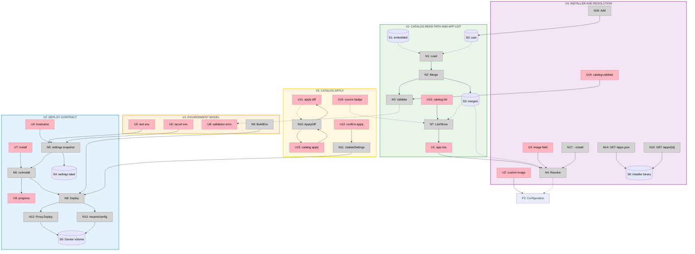

# App Catalog — Slices

Selected shape: **A — Local-first single-file manifests**
Ground truth for R, fit check, parts, and breadboard: [`shaping.md`](shaping.md)
Related: [`../../specs/app-catalog.md`](../../specs/app-catalog.md) · [`../oma-fork-plan.md`](../oma-fork-plan.md)

Each slice is vertical: it ends with a demo-able user-visible result. Slices may land as separate commits or pull requests, but each keeps the build and tests green.

## Slice Overview

| # | Slice | Mechanism | Demo |
| --- | --- | --- | --- |
| V1 | Catalog read path and app list | Embedded and user manifests load, validate, merge; TUI and CLI list metadata | The app list is driven by YAML; a local manifest appears without a rebuild |
| V2 | Deploy contract | Port, health, TLS, verification, mount targets, settings snapshot | A nonstandard web app deploys and survives restart |
| V3 | Environment model | Required, default, generated, secret values; install form | An app requiring `DATABASE_URL` prompts for it and installs |
| V4 | Installer and install resolution | `/apps.json`, `/apps/{id}`, `--install` resolution, catalog add | A hosted install URL and a local catalog ID both install |
| V5 | Catalog apply | Diff, preview, confirmation, allowed field subset | Editing a manifest previews changes and applies them without touching env |

V1 is a prerequisite for V2–V5. V2 and V3 are independent after V1. V4 depends on V1. V5 depends on V2 and V3.

## Sliced Breadboard

## V1: Catalog Read Path and App List

Status: complete.

**Goal:** The catalog is data, and both TUI and CLI read it.

**Parts:** A1, A2, A3, A4, A10

**Affordances**

| # | Affordance | Control | Notes |
| --- | --- | --- | --- |
| U1 | App row: name, description, category, source | click | Replaces the hardcoded list |
| U13 | `oma catalog list` table | invoke | Same merged catalog as the TUI |
| U14 | `oma catalog validate` report | invoke | One invalid user file does not break the list |
| N1 | `catalog.Load()` | call | Reads embedded and user manifests |
| N2 | `catalog.Merge()` | call | Whole-entry replacement by `id`, deterministic order |
| N3 | `catalog.Validate()` | call | File-aware errors |
| N7 | `catalog.List()` / `Show()` | call | Returns validated entries |
| S1 | Embedded catalog | store | Built-ins |
| S2 | User catalog | store | `$XDG_CONFIG_HOME/oma/apps` |
| S3 | Merged catalog | store | In memory |

**Demo:** Start Oma with a user manifest in `~/.config/oma/apps`; the app appears in the list with its description and source. `oma catalog list` shows the same entry.

**Acceptance**

- Built-in Campfire, Fizzy, and Writebook still appear.
- A user manifest with a new `id` appears without a rebuild.
- A user manifest with an existing `id` replaces the embedded entry.
- A malformed user manifest is skipped with a file-and-field error; other entries remain.
- Deterministic order: category, then name, then `id`.
- No deploy behavior changes in this slice.

**Out of scope:** Custom ports, health paths, env prompts, installer routes, apply.

## V2: Deploy Contract

Status: complete.

**Goal:** Catalog values control deployment without breaking existing apps.

**Parts:** A5, A6

**Affordances**

| # | Affordance | Control | Notes |
| --- | --- | --- | --- |
| U4 | Hostname field | type | Suggested value comes from the manifest |
| U7 | Install button | click | Uses resolved settings |
| U9 | Progress stages | render | Pull, start, verify |
| N5 | Settings snapshot | call | Copies manifest values into `ApplicationSettings` |
| N6 | `runInstall()` | call | Existing install flow |
| N8 | `Application.Deploy()` | call | Uses snapshot |
| N12 | `Proxy.Deploy()` | call | Receives target port and health flags |
| N13 | Mounts and container config | call | Multiple mount targets on one volume |
| S4 | Settings label | store | Optional new fields |
| S5 | Docker volume | store | One named volume |

**Demo:** Install an app that serves on port 3000 with `/healthz` and stores data at `/data`. It deploys, passes verification, survives restart, and backs up.

**Acceptance**

- `web.port: 3000` produces `--target <id>:3000`.
- `web.healthPath: /healthz` is used by both the proxy and HTTP verification.
- Multiple mount targets point at the same named volume.
- `tls: off` disables `--tls` and sets `DISABLE_SSL`.
- `verify: false` skips HTTP verification without deleting data.
- Existing apps with no catalog fields deploy exactly as before.
- Old settings labels unmarshal; new fields are optional.
- Backup and restore still use the primary mount target.

**Out of scope:** Multiple named volumes, custom command/user beyond the minimal settings field, non-web apps.

## V3: Environment Model

Status: complete.

**Goal:** A manifest can declare the env an app needs, and the install UI collects it.

**Parts:** A7, A10

**Affordances**

| # | Affordance | Control | Notes |
| --- | --- | --- | --- |
| U5 | Text env field | type | Required and optional |
| U6 | Secret env field | type | Masked |
| U8 | Validation error banner | render | Missing required value |
| N5 | Settings snapshot | call | Stores resolved env values |
| N9 | `BuildEnv()` | call | Generated, system-derived, and user values |

**Demo:** An app manifest requires `DATABASE_URL` and a generated `SECRET_KEY_BASE`. The install form asks for the URL, generates the secret, and the app starts.

**Acceptance**

- Required env values block install until supplied.
- Defaults are prefilled.
- Generated values are created once and persisted in settings.
- Secret fields are masked in the TUI and CLI output.
- `BASE_URL`, `DISABLE_SSL`, and SMTP values are derived from existing settings.
- User-provided env overrides generated values only where the schema allows it.
- No secret is printed in normal CLI output or logs.

**Out of scope:** Typed number/boolean/select fields, conditional fields, remote secret stores.

## V4: Installer and Install Resolution

**Goal:** Embedding and user catalogs both resolve at install time, and the hosted installer serves embedded data.

**Parts:** A2, A9, A10

**Affordances**

| # | Affordance | Control | Notes |
| --- | --- | --- | --- |
| U2 | Custom image row | click | Falls back to image entry |
| U3 | Image field | type | Resolves ID, alias, or image |
| U14 | `catalog validate` | invoke | Embedded and user files |
| N4 | `catalog.Resolve()` | call | User, embedded, alias, raw image |
| N14 | `GET /apps.json` | serve | Embedded catalog only |
| N15 | `GET /apps/{id}` | serve | Emits `--install=<id>` |
| N16 | `catalog add` | call | Writes a user manifest |
| N17 | `--install=<id-or-image>` | invoke | Works for scripts |
| S6 | Installer binary | store | Embedded catalog |

**Demo:** `curl https://<installer>/apps/writebook | sh` installs Writebook. A locally added `myapp` installs with `oma --install=myapp`. A raw image reference still works.

**Acceptance**

- `/apps.json` contains embedded entries only.
- `/apps/{id}` returns a shell script with `--install=<id>`.
- `/ghcr.io/foo/bar` remains a valid raw-image route.
- `--install=campfire` resolves the alias.
- `--install=myapp` resolves a user catalog entry.
- `--install=ghcr.io/foo/bar` resolves a raw image.
- A user catalog entry cannot be used to construct a hosted installer URL.
- Invalid IDs are rejected before the shell template is rendered.

**Out of scope:** Remote catalogs, signing, installer UI beyond the shell script.

## V5: Catalog Apply

**Goal:** A manifest change can be reviewed and applied explicitly, without silent redeploys or env overwrites.

**Parts:** A8, A10

**Affordances**

| # | Affordance | Control | Notes |
| --- | --- | --- | --- |
| U10 | Source badge | render | Shows `builtin` or `user` |
| U11 | Apply diff | render | Field-level before and after |
| U12 | Confirm apply | click | Requires confirmation or `--yes` |
| U15 | `oma catalog apply` | invoke | CLI equivalent |
| N10 | `ApplyDiff(host)` | call | Compares settings to manifest |
| N11 | `UpdateSettings()` | call | Redeploys with no pull |

**Demo:** Edit a user manifest to change the image tag and health path. `oma catalog apply books.example.com --dry-run` shows both changes; applying does not touch the app's env or secrets.

**Acceptance**

- Diff includes only the supported subset: image, service port, health settings, TLS mode, verification, resources, and additional mount targets.
- Env values and secrets are not overwritten by default.
- Confirmation is required unless `--yes` is passed.
- Apply uses `UpdateSettings`, not `Deploy`, so it does not pull a new image tag unless the image field itself changed.
- A failed apply restores the previous settings.
- Removing an entry from the catalog does not affect installed apps.
- Installed apps are unchanged when their manifest changes until apply runs.

**Out of scope:** Automatic apply, catalog-driven rollback, env migration.

## Slice Grid

|  |  |  |
| :-- | :-- | :-- |
| **V1: Catalog Read Path and App List** ✅ COMPLETE  • Manifest schema and validation • Embedded and user loaders • Merge by ID • TUI and CLI list metadata  *Demo: A local manifest appears without a rebuild* | **V2: Deploy Contract** ✅ COMPLETE  • Port and health flags • Mount targets • TLS and verification • Settings snapshot  *Demo: An app on port 3000 with `/healthz` deploys* | **V3: Environment Model** ✅ COMPLETE  • Required, default, generated values • Secret fields • Install form • Env build  *Demo: A required `DATABASE_URL` is prompted and installed* |
| **V4: Installer and Install Resolution** ⏳ PENDING  • `/apps.json` and `/apps/{id}` • ID, alias, image resolution • `catalog add` • `--install` paths  *Demo: Hosted and local catalog installs both work* | **V5: Catalog Apply** ⏳ PENDING  • Diff and preview • Explicit confirmation • Safe field subset • No env overwrite  *Demo: Edit a manifest and preview the change* | **V6: Deferred Extensions** ⏳ OUT OF SCOPE  • Multiple named volumes • Worker apps • Multi-container stacks • Remote catalogs  *Demo: Not part of this release* |
