# Hardening — Shaping

Status: workstreams selected; V1–V2 implemented, V3 next
Phase: 4 — automation and hardening
Related: [`slices.md`](slices.md) · [`../../specs/hardening.md`](../../specs/hardening.md) · [`../oma-fork-plan.md`](../oma-fork-plan.md)

## Frame

### Problem

Oma can now install apps locally and on remote targets, but four operational gaps remain:

- Installer and self-update downloads are not integrity-checked.
- Remote backups are controller-side and are lost to a sleeping or failed controller.
- LAN deployments have no secure TLS option beyond turning TLS off.
- The installer requires local Docker even when the user only wants a controller for remote targets.

Release signing, remote catalog signing, object-storage backups, and self-signed certificates are not required to close these gaps.

### Outcome

- Every downloaded release binary is checked against the published checksum before installation or replacement.
- Backup ownership is explicit: controller-side by default, target-side with an optional runner, with a download/restore path.
- LAN TLS supports user-provided certificates without ACME or browser-warning self-signed certificates.
- Oma can be installed on a controller without local Docker, then pointed at a prepared remote target.
- Existing local and remote behavior remains unchanged unless an operator opts into a new mode.

## Requirements

| ID | Requirement | Status |
| --- | --- | --- |
| R0 | Installer verifies the downloaded binary against a published SHA-256 checksum | Must-have |
| R1 | Self-updater verifies the downloaded binary against a published SHA-256 checksum | Must-have |
| R2 | Checksum mismatch fails closed and leaves the existing binary/service intact | Must-have |
| R3 | Release signing is deferred; checksums are delivered over the release's HTTPS channel | Out |
| R4 | Backup destination is explicit per app: controller-side or target-side | Must-have |
| R5 | Controller-side remains the default for existing installs | Must-have |
| R6 | Target-side backups require an optional target-local Oma runner and remain restoreable | Must-have |
| R7 | The controller can list and download target-side backups over the target connection | Must-have |
| R8 | Target-side backups use the shared operation lock | Must-have |
| R9 | LAN TLS supports a user-provided certificate and key, with TLS auto and off retained | Must-have |
| R10 | Missing or invalid certificate material fails before deployment with an actionable error | Must-have |
| R11 | Self-signed certificate generation and ACME DNS-01 are deferred | Out |
| R12 | Installer supports a controller-only mode that skips local Docker installation and checks | Must-have |
| R13 | Local-target commands fail clearly in controller-only mode when Docker is absent | Must-have |
| R14 | Remote catalog signatures and trust policy are out of scope because remote catalogs are deferred | Out |
| R15 | Object-storage backups are out of scope | Out |
| R16 | Secrets are not written to logs by the new backup, TLS, or installer paths | Must-have |
| R17 | Existing checksum-less local installs and controller-side backups keep working | Must-have |
| R18 | New modes are documented in the CLI/TUI and do not change defaults silently | Must-have |

Out-of-scope rows are not scored.

## Workstreams

### S1 Release integrity

#### S1-A: HTTPS plus SHA-256 checksums (selected)

| Part | Mechanism |
| --- | --- |
| **S1-A1** | Release publishes `checksums.txt` containing SHA-256 for every binary |
| **S1-A2** | Installer downloads the checksum file and verifies the selected asset before install |
| **S1-A3** | Self-updater downloads the checksum file and verifies before replacing the binary |
| **S1-A4** | Failure leaves the current binary/service untouched |

#### S1-B: Detached Ed25519 signature

Sign `checksums.txt` and embed a public key in releases. Add signature verification to the self-updater; installer verification depends on available tooling.

#### S1-C: Sigstore/cosign attestations

Use GitHub artifact attestations or cosign bundles. Strongest identity binding, but adds external verification tooling to the installer.

**Fit**

| Req | S1-A | S1-B | S1-C |
| --- | --- | --- | --- |
| R0 | ✅ | ✅ | ✅ |
| R1 | ✅ | ✅ | ✅ |
| R2 | ✅ | ✅ | ✅ |

S1-A is selected. Signatures are a deliberate deferral, not a silent omission; they are a separate supply-chain project.

### S2 Backup ownership

#### S2-A: Controller-side only (status quo)

Backups stream over the Docker API and land on the controller. Simple and already implemented, but a sleeping controller stops VPS backups.

#### S2-B: Explicit controller or target destination (selected)

| Part | Mechanism |
| --- | --- |
| **S2-B1** | Per-app backup destination: `controller` or `target` |
| **S2-B2** | Controller-side remains the default |
| **S2-B3** | Target-side requires an Oma runner on the target; manual installation is documented first |
| **S2-B4** | Target runner writes backups to a target-local path under the existing background service |
| **S2-B5** | Controller can list and download target-side backups through the target connection |
| **S2-B6** | Restore accepts a downloaded target-side archive |
| **S2-B7** | Both paths use the shared operation lock |

#### S2-C: Object storage

Push backups to an S3-compatible bucket from the controller or target. Strong durability, but adds credentials, lifecycle, and provider support.

**Fit**

| Req | S2-A | S2-B | S2-C |
| --- | --- | --- | --- |
| R4 | ❌ | ✅ | ✅ |
| R5 | ✅ | ✅ | ✅ |
| R6 | ❌ | ✅ | ✅ |
| R7 | ❌ | ✅ | ✅ |
| R8 | ✅ | ✅ | ✅ |

S2-B is selected. S2-A fails target-side ownership and download. S2-C is deferred.

### S3 LAN TLS

#### S3-A: TLS off only (status quo)

HTTP only on LAN or custom DNS. Fails secure LAN use.

#### S3-B: User-provided certificate and key (selected)

| Part | Mechanism |
| --- | --- |
| **S3-B1** | Per-app TLS mode: `auto`, `off`, or `custom` |
| **S3-B2** | Custom mode takes certificate and key file paths from the controller |
| **S3-B3** | Files are copied into the proxy volume and referenced by proxy TLS flags |
| **S3-B4** | Certificate/key validation happens before deploy/apply |
| **S3-B5** | `auto` retains ACME behavior; `off` retains HTTP behavior |
| **S3-B6** | Apply-diff includes TLS mode and certificate changes |

#### S3-C: Self-signed certificates generated by Oma

Easy to generate, but clients see warnings unless a local CA is installed.

#### S3-D: Local CA / mkcert guidance only

No implementation; document how to create and install a certificate manually.

**Fit**

| Req | S3-A | S3-B | S3-C | S3-D |
| --- | --- | --- | --- | --- |
| R9 | ❌ | ✅ | ✅ | ❌ |
| R10 | ✅ | ✅ | ✅ | ❌ |

S3-B is selected. S3-C is deferred because browser trust is the hard part, not certificate generation. S3-D remains documentation, not a product mode.

### S4 Controller-only installer

#### S4-A: Environment-gated Docker skip (selected)

| Part | Mechanism |
| --- | --- |
| **S4-A1** | `OMA_LOCAL_DOCKER=false` skips local Docker installation/checks |
| **S4-A2** | Binary and background service install normally |
| **S4-A3** | Documentation covers `oma target add/setup` before first local command |
| **S4-A4** | Local target errors clearly when Docker is unavailable |

#### S4-B: First-run controller wizard

Installer launches a target setup wizard before the normal TUI. Better UX, more installer/TUI coupling.

#### S4-C: Separate controller-only binary

A second artifact with local Docker code removed. Duplicates release and test surface for little benefit.

**Fit**

| Req | S4-A | S4-B | S4-C |
| --- | --- | --- | --- |
| R12 | ✅ | ✅ | ✅ |
| R13 | ✅ | ✅ | ✅ |
| R17 | ✅ | ✅ | ✅ |
| R18 | ✅ | ✅ | ✅ |

S4-A is selected for the smallest surface. S4-B can be layered on later.

### S5 Remote catalog trust

Remote catalogs are deferred by the catalog contract. Their manifest signing, key rotation, and trust policy are out of scope. No catalog signature work is included in Phase 4.

## Selected Parts

| Part | Mechanism |
| --- | --- |
| **H1** | Installer checksum fetch and verification |
| **H2** | Self-updater checksum fetch and verification |
| **H3** | Backup destination setting and target-side runner path |
| **H4** | Target backup list/download and restore |
| **H5** | Custom TLS mode, certificate/key copy, proxy flags, validation |
| **H6** | Controller-only installer mode |
| **H7** | Tests, documentation, and compatibility checks |

## Breadboard

### Places

| # | Place | Description |
| --- | --- | --- |
| P1 | Installer | Shell bootstrap, checksum verification, Docker skip |
| P2 | Self-updater | Binary download, checksum verification, replacement |
| P3 | CLI/TUI backup settings | Backup destination, list, download |
| P4 | CLI/TUI TLS settings | TLS mode and certificate paths |
| P5 | Proxy | TLS termination and certificate files |
| P6 | Target runner | Target-local update/backup service |
| P7 | Target storage | Target-side backup directory |

### UI Affordances

| # | Place | Component | Affordance | Control | Wires Out | Returns To |
| --- | --- | --- | --- | --- | --- | --- |
| U1 | P3 | Backup settings | Destination selector: controller/target | select | → N3 | — |
| U2 | P3 | Backup list | List target-side backups | invoke | → N5 | — |
| U3 | P3 | Backup list | Download selected backup | click | → N6 | — |
| U4 | P4 | Application settings | TLS mode selector | select | → N7 | — |
| U5 | P4 | Application settings | Certificate and key path fields | type | → N8 | — |
| U6 | P4 | Settings/error | Validation error line | render | — | → N8 |
| U7 | P1 | Installer output | Checksum failure message | render | — | → N2 |
| U8 | P3 | Backup settings | Target-runner requirement note | render | — | → N3 |

### Code Affordances

| # | Place | Component | Affordance | Control | Wires Out | Returns To |
| --- | --- | --- | --- | --- | --- | --- |
| N1 | P1 | installer | Discover release assets and checksums | call | → N2 | → U7 |
| N2 | P1 | installer | Verify SHA-256 before install | call | → P1 | → U7 |
| N3 | P3 | backup settings | Persist backup destination | call | → S1 | → U1 |
| N4 | P2 | updater | Download checksums and verify binary | call | → P2 | → N2 |
| N5 | P3 | backup list | List target backup directory | call | → P7 | → U2 |
| N6 | P3 | backup download | Stream target backup to controller | call | → S2 | → U3 |
| N7 | P4 | TLS settings | Persist TLS mode | call | → S1 | → U4 |
| N8 | P4 | TLS validation | Validate certificate/key and copy to proxy volume | call | → P5 | → U6 |
| N9 | P6 | target runner | Run target-local update/backup | call | → P7, S3 | → P7 |
| N10 | P1 | installer | Skip local Docker when controller-only | call | → P1 | — |

### Data Stores

| # | Store | Description |
| --- | --- | --- |
| S1 | App settings | TLS mode, cert/key paths, backup destination |
| S2 | Controller storage | Downloaded target-side backups |
| S3 | Operation lock | Shared deploy/update/backup lock |
| P7 | Target storage | Target-side backup archives |

### Wiring

```mermaid
flowchart TB
  subgraph P1["P1: Installer"]
    U7["U7: checksum failure"]
    N1["N1: release assets"]
    N2["N2: verify checksum"]
    N10["N10: skip local Docker"]
  end

  subgraph P2["P2: Self-updater"]
    N4["N4: download and verify"]
  end

  subgraph P3["P3: Backup settings"]
    U1["U1: destination selector"]
    U2["U2: backup list"]
    U3["U3: download"]
    U8["U8: runner note"]
    N3["N3: save destination"]
    N5["N5: list target backups"]
    N6["N6: download backup"]
  end

  subgraph P4["P4: TLS settings"]
    U4["U4: TLS mode"]
    U5["U5: cert/key paths"]
    U6["U6: validation error"]
    N7["N7: save TLS mode"]
    N8["N8: validate and copy certs"]
  end

  subgraph P5["P5: Proxy"]
    PROXY["TLS termination"]
  end

  subgraph P6["P6: Target runner"]
    N9["N9: target update/backup"]
  end

  subgraph P7["P7: Target storage"]
    BACKUPS[("Target backups")]
  end

  S1[("S1: app settings")]
  S2[("S2: controller backups")]
  S3[("S3: operation lock")]

  U1 --> N3
  N3 --> S1
  N3 --> U8
  U2 --> N5
  N5 --> BACKUPS
  N5 --> U2
  U3 --> N6
  N6 --> S2
  U4 --> N7
  U5 --> N8
  N7 --> S1
  N8 --> PROXY
  N8 --> U6
  N9 --> BACKUPS
  N9 --> S3
  N1 --> N2
  N2 --> U7
  N4 --> N2
  N10 --> P1

  classDef ui fill:#ffb6c1,stroke:#d87093,color:#000
  classDef nonui fill:#d3d3d3,stroke:#808080,color:#000
  classDef store fill:#e6e6fa,stroke:#9370db,color:#000

  class U1,U2,U3,U4,U5,U6,U7,U8 ui
  class N1,N2,N3,N4,N5,N6,N7,N8,N9,N10 nonui
  class S1,S2,S3,BACKUPS store
```

**Legend**

- Pink nodes are UI affordances.
- Grey nodes are code affordances.
- Purple nodes are data stores.
- Solid arrows are control flow.
- Dashed arrows are data flow.

## Operational Semantics

- **Checksums:** the installer and updater both fail closed; a failed verification never replaces the current binary. The checksum file is fetched from the same release as the binary.
- **Backups:** controller-side remains the default. Target-side requires an Oma runner on the target and a target-local path; the controller downloads archives through the target connection. Restore accepts either location.
- **TLS:** `auto` uses ACME, `off` uses HTTP, and `custom` uses the configured certificate/key. Custom files are validated before deployment and copied into the proxy volume.
- **Installer:** `OMA_LOCAL_DOCKER=false` skips local Docker checks/installation. The binary and service still install. Local commands fail with a clear Docker error until a local daemon is available.
- **Signing:** release signatures, catalog signatures, self-signed certificates, ACME DNS-01, object storage, and a controller-only setup wizard are not part of this phase.

## Notes for Implementation

- Verify checksums with a portable SHA-256 helper in the shell installer.
- Validate certificate material before any container or proxy mutation.
- Keep controller-side backup default to avoid silent migration.
- Use the existing operation lock for target-side backup writes.
- Do not add secrets to logs; certificate paths may be logged, private key contents must not.
