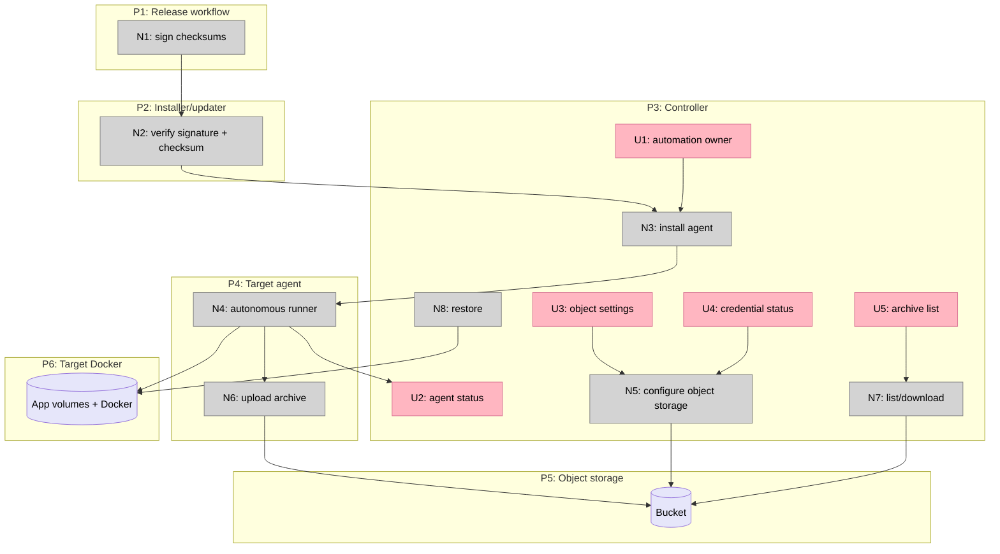

# Phase 6 — Remote Autonomy, Supply Chain, Storage

Status: V1–V2 implemented; V3 next
Phase: 6
Related: [`slices.md`](slices.md) · [`../release/shaping.md`](../release/shaping.md) · [`../oma-fork-plan.md`](../oma-fork-plan.md)

## Frame

### Problem

Oma can manage remote targets, but remote automation still depends on the controller. Backups are either controller-side or require a manually installed target runner, and there is no offsite storage path. Release downloads are checksum-verified, but there is no signature chain, so a compromised release account could replace both the binary and its checksum. These three gaps reinforce each other:

- Without an agent, a sleeping controller stops remote updates and backups.
- Without signed artifacts, an agent installer and self-updater trust the same unsigned download path.
- Without object storage, even an autonomous runner can only store backups on the target disk.

### Outcome

- Release artifacts and the target agent are signed and verified fail-closed.
- A target can run the signed Oma agent as a background runner without a public listener, with status and logs reachable over the existing SSH path.
- The agent owns updates and backups for opted-in targets; the controller does not duplicate that work.
- Object-storage backups are written from the agent or runner, survive controller downtime, and can be listed, downloaded, and restored.
- Existing controller-side and target-side backup defaults remain compatible.

## Requirements

| ID | Requirement | Status |
| --- | --- | --- |
| R0 | Release checksums and agent artifacts are signed | Must-have |
| R1 | Installer, self-updater, and agent installation reject bad signatures | Must-have |
| R2 | Signing keys have an explicit rotation/revocation path | Must-have |
| R3 | No signing private key is stored in the repository | Must-have |
| R4 | A target can run Oma autonomously without a controller | Must-have |
| R5 | The agent is installed and updated over SSH with signed artifacts | Must-have |
| R6 | The agent exposes no new public network listener | Must-have |
| R7 | Agent status and logs are reachable through the controller | Must-have |
| R8 | Controller and agent do not duplicate updates or backups for the same app | Must-have |
| R9 | Existing remote targets remain controller-driven by default | Must-have |
| R10 | Object-storage backups can be written while the controller is offline | Must-have |
| R11 | Object-storage credentials are not stored in Docker labels or logs | Must-have |
| R12 | Object-storage backups support retention and encryption options | Must-have |
| R13 | Object-storage archives can be listed, downloaded, and restored | Must-have |
| R15 | Existing checksum-only verification remains compatible until migration completes | Must-have |
| R16 | Release and agent installation documentation covers key rotation and rollback | Must-have |

## Workstreams

### S1: Supply chain

#### S1-A: Checksums over HTTPS (current)

The installer and self-updater verify SHA-256 checksums. This detects corruption but not a compromised release account.

#### S1-B: Detached RSA-SHA256 signatures (selected)

| Part | Mechanism |
| --- | --- |
| **S1-B1** | Sign `checksums.txt` with a release private key; publish `checksums.txt.sig` |
| **S1-B2** | Sign agent artifacts through the same checksum manifest |
| **S1-B3** | Embed the public key and key ID in the installer and updater |
| **S1-B4** | Installer verifies the signature with portable OpenSSL tooling before checksum verification |
| **S1-B5** | Self-updater and agent installer verify the same signature in-process |
| **S1-B6** | Publish key rotation/revocation metadata alongside releases |

#### S1-C: Sigstore/cosign

Strong identity binding, but requires cosign or an attestation verifier in the installer and agent install path.

**Fit**

| Req | S1-A | S1-B | S1-C |
| --- | --- | --- | --- |
| R0 | ❌ | ✅ | ✅ |
| R1 | ❌ | ✅ | ✅ |
| R2 | ❌ | ✅ | ✅ |
| R3 | ✅ | ✅ | ✅ |
| R15 | ✅ | ✅ | ✅ |

S1-B is selected. OpenSSL/LibreSSL support for RSA-SHA256 is broader than a cosign or minisign prerequisite. S1-C remains a future option if identity-bound attestations become necessary.

### S2: Agent

#### S2-A: SSH-managed signed runner (selected)

| Part | Mechanism |
| --- | --- |
| **S2-A1** | Install the signed Oma binary and a target-local service over SSH |
| **S2-A2** | Run the agent as a local-target background runner with an agent role |
| **S2-A3** | Keep automation ownership per target: controller or agent |
| **S2-A4** | Agent performs self-update, app updates, and backups when it owns automation |
| **S2-A5** | Controller status/logs use existing SSH commands and service inspection |
| **S2-A6** | Agent installation and update are idempotent and rollbackable |

#### S2-B: Network agent daemon

A long-lived agent API over mTLS or a controller tunnel, with enrollment and authentication.

**Advantages:** richer control plane.

**Risks:** new listener, credentials, protocol, and attack surface before the product needs them.

#### S2-C: Controller-driven only

Current behavior. Fails controller-offline autonomy.

**Fit**

| Req | S2-A | S2-B | S2-C |
| --- | --- | --- | --- |
| R4 | ✅ | ✅ | ❌ |
| R5 | ✅ | ✅ | ❌ |
| R6 | ✅ | ❌ | ✅ |
| R7 | ✅ | ✅ | ✅ |
| R8 | ✅ | ✅ | ✅ |
| R9 | ✅ | ✅ | ✅ |

S2-A is selected. It preserves SSH as the only remote control channel and deliberately avoids a new network daemon.

### S3: Object storage

#### S3-A: Direct S3-compatible writes from the runner (selected)

| Part | Mechanism |
| --- | --- |
| **S3-A1** | Add an `object` backup destination with bucket, prefix, and endpoint settings |
| **S3-A2** | Store credentials in a target-local 0600 secret file, never app labels |
| **S3-A3** | Upload the existing tar.gz archive using an S3-compatible SigV4 client |
| **S3-A4** | Apply server-side encryption and retention rules |
| **S3-A5** | List and download archives through the agent/controller path |
| **S3-A6** | Restore from a downloaded object archive through the existing restore path |

#### S3-B: Controller uploads

The controller writes archives to object storage. Simple, but fails controller-offline autonomy and duplicates credentials.

#### S3-C: restic/rclone

Delegate storage and encryption to an external backup tool. Strong utility, but introduces a new binary, format, and restore path.

#### S3-D: Presigned URLs issued by the controller

The target uploads with a presigned URL. Credentials stay on the controller, but the controller must be online to issue URLs and the agent needs a callback path.

**Fit**

| Req | S3-A | S3-B | S3-C | S3-D |
| --- | --- | --- | --- | --- |
| R10 | ✅ | ❌ | ✅ | ❌ |
| R11 | ✅ | ✅ | ✅ | ✅ |
| R12 | ✅ | ✅ | ✅ | ✅ |
| R13 | ✅ | ✅ | ✅ | ✅ |

S3-A is selected. S3-C is attractive for encryption but would replace the existing archive/restore contract; it belongs in a separate storage decision.

## Selected Parts

| Part | Mechanism |
| --- | --- |
| **P1** | RSA-SHA256 signed checksums and agent artifacts |
| **P2** | Installer/updater/agent signature verification with key rotation |
| **P3** | Signed target-local agent installed over SSH |
| **P4** | Per-target automation ownership and agent status/logs |
| **P5** | S3-compatible object backup destination |
| **P6** | Object archive listing, download, retention, and restore |
| **P7** | Compatibility defaults and rollout documentation |

## Breadboard

### Places

| # | Place | Description |
| --- | --- | --- |
| P1 | Release workflow | Sign checksums and publish verification metadata |
| P2 | Installer/updater | Verify signature and checksum before installation |
| P3 | Controller CLI/TUI | Agent install, ownership, object-storage settings |
| P4 | Target agent | Signed Oma runner, updates, backups, status |
| P5 | Object storage | S3-compatible bucket and archives |
| P6 | Target Docker | App volumes and Docker API |

### UI Affordances

| # | Place | Component | Affordance | Control | Wires Out | Returns To |
| --- | --- | --- | --- | --- | --- | --- |
| U1 | P3 | Target settings | Automation owner: controller/agent | select | → N3 | — |
| U2 | P3 | Target status | Agent status and service log | invoke | → N4 | → U2 |
| U3 | P3 | Backup settings | Object-storage destination, bucket, prefix | type | → N5 | — |
| U4 | P3 | Backup settings | Credential status, never secret value | render | → N5 | → U3 |
| U5 | P3 | Backup list | List object archives and restore selection | invoke | → N7 | → U5 |

### Non-UI Affordances

| # | Place | Component | Affordance | Control | Wires Out | Returns To |
| --- | --- | --- | --- | --- | --- | --- |
| N1 | P1 | Signing | Sign `checksums.txt` and publish key metadata | call | → P1 | → N2 |
| N2 | P2 | Verification | Verify signature then checksum, fail closed | call | → N3 | → U2 |
| N3 | P3 | Agent install | Upload signed binary, install service, enable agent role | call | → N4 | → U1 |
| N4 | P4 | Agent runner | Self-update, app update, backup on local target | call | → P6, P5 | → U2 |
| N5 | P3 | Object config | Push bucket/prefix settings and 0600 credentials over SSH | call | → P5 | → U4 |
| N6 | P4 | Upload | Write tar.gz archive to object storage with encryption/retention | call | → P5 | → U3 |
| N7 | P3 | List/download | List objects and download an archive | call | → P5 | → U5 |
| N8 | P3 | Restore | Feed downloaded archive into existing restore path | call | → P6 | → U5 |

### Wiring

**Legend:**

- Pink nodes are operator surfaces.
- Grey nodes are release/runtime mechanisms.
- Purple nodes are stored state.
- Solid arrows are control flow.

## Operational Semantics

- **Signing:** the release signs the checksum manifest; the installer verifies with OpenSSL, and Oma's own updater/agent verifies in-process. Signature failure aborts before checksum or installation.
- **Agent:** installation is an SSH operation using the existing target credentials. No new public port is opened. The agent owns automation only when selected per target.
- **Storage:** object backups are written by whichever process owns backup automation. Credentials live in a 0600 target file. Existing controller- and target-side destinations remain available.
- **Compatibility:** existing targets remain controller-driven; checksum-only verification continues to work until signed releases are mandatory.
- **Out of scope:** network agent API, fleet scheduling, non-S3 providers, and a new archive format.

## Notes for Implementation

- Keep the signing public key in a single embedded trust root; publish key IDs for rotation.
- Do not put object-storage credentials in application settings labels.
- Reuse the existing tar.gz backup and restore contract for object storage.
- Agent status must not require a new daemon endpoint; use SSH and the service manager.
- Ensure controller and agent ownership cannot both run updates/backups for the same target.
