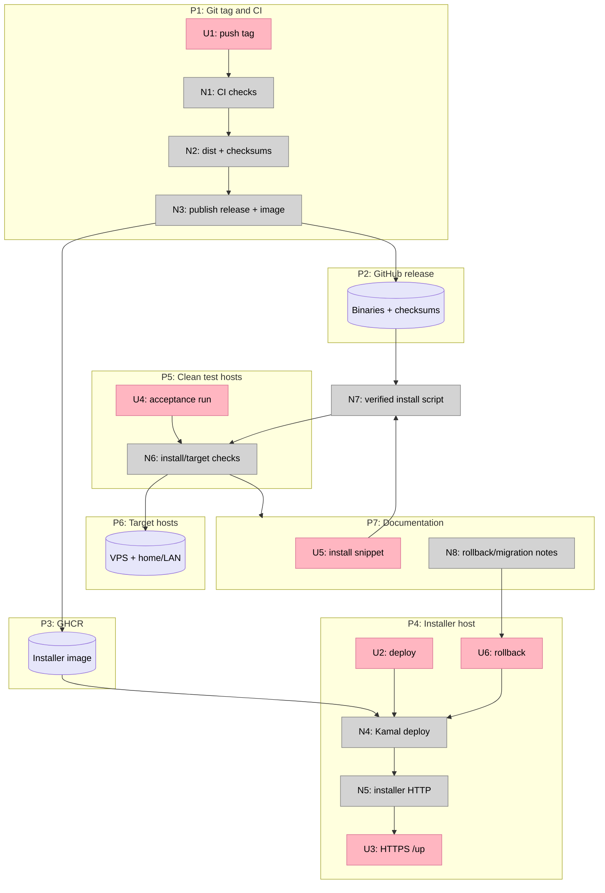

# Release — Shaping

Status: shape selected; V1–V2 implemented, V3 macOS pending, V4 remote-VM pass
Phase: 5 — release
Related: [`slices.md`](slices.md) · [`../../specs/release.md`](../../specs/release.md) · [`../oma-fork-plan.md`](../oma-fork-plan.md)

## Frame

### Problem

Oma is functionally complete but not distributable. The release workflow publishes binaries, but there is no published installer image, the installer service still points at `get.oma.example`, and no clean-host, VPS, or LAN acceptance run has proved the hosted path end to end. The README still tells users to build from source.

A user should be able to paste one install command, receive a verified binary, and choose either a local Docker host or a remote target. The maintainer needs a repeatable release and rollback process that does not depend on a local build or an unstated domain.

### Outcome

- A tagged release publishes four Oma binaries, `checksums.txt`, and a tagged installer image.
- The installer service is reachable over HTTPS at an explicitly chosen hostname and serves the install script.
- Clean Linux, macOS, Docker-free controller, VPS target, and home/LAN target runs pass.
- The install command and support boundary are documented.
- ONCE migration is explicitly not supported; Oma starts clean.
- A bad installer image can be rolled back, and a bad binary release has a documented forward-fix path.

## Requirements

| ID | Requirement | Status |
| --- | --- | --- |
| R0 | Publish Oma binaries for Linux and macOS on amd64 and arm64, with checksums | Must-have |
| R1 | Publish an installer container image in a public registry | Must-have |
| R2 | Pin the installer deployment to an immutable image tag | Must-have |
| R3 | Deploy the installer service at a final HTTPS hostname | Must-have |
| R4 | The installer must serve the current install script and catalog routes | Must-have |
| R5 | The install script must verify release checksums before installing | Must-have |
| R6 | Verify a clean Linux install on a host without Docker | Must-have |
| R7 | Verify a clean macOS install with Docker Desktop | Must-have |
| R8 | Verify a Docker-free controller install and remote target operation | Must-have |
| R9 | Verify a clean VPS target deployment | Must-have |
| R10 | Verify a home/LAN target deployment, including custom TLS | Must-have |
| R11 | Provide a release checklist, rollback steps, and install documentation | Must-have |
| R12 | Document that ONCE migration is out of scope and Oma starts clean | Must-have |
| R13 | Use a stable/pre-release release channel; installer uses only stable latest | Must-have |
| R14 | Keep deployment credentials and live server addresses out of committed files | Must-have |
| R15 | The installer service exposes a health endpoint for deployment checks | Must-have |
| R16 | Release signing and installer artifact signing are deferred | Out |
| R17 | Multi-region and fleet deployment are out of scope | Out |

## Shapes

### A: GHCR artifacts, Kamal-hosted installer (selected)

| Part | Mechanism |
| --- | --- |
| **A1** | Tag-driven release job runs CI, builds `make dist`, and verifies checksums |
| **A2** | GitHub Actions builds and pushes a multi-arch installer image to GHCR with the release tag |
| **A3** | Committed Kamal template points at the GHCR image; live host and servers are supplied at deploy time |
| **A4** | DNS, ports 80/443, Kamal TLS, and `/up` health check |
| **A5** | Clean-host, VPS, home/LAN, and controller-only acceptance checklist |
| **A6** | README install command, release notes, rollback guide, and ONCE migration statement |

### B: GHCR artifacts, Oma-hosted installer

Oma deploys its own installer image to a VPS target. This dogfoods the remote-target path and removes Kamal from the release toolchain.

**Advantages:** proves the product while shipping it; one deployment model.

**Risks:** bootstrapping depends on a working source-built Oma controller; a failure in the release path blocks the release gate; no existing deployment config.

### C: Static or serverless installer

Render the install script as a static asset or edge function, with catalog data embedded or fetched separately.

**Advantages:** no long-lived installer server.

**Risks:** loses the existing dynamic image-reference and catalog routes unless they are reimplemented; introduces a second runtime; less direct rollback.

## Fit Check

| Req | Requirement | Status | A | B | C |
| --- | --- | --- | --- | --- | --- |
| R0 | Publish Oma binaries for Linux and macOS on amd64 and arm64, with checksums | Must-have | ✅ | ✅ | ✅ |
| R1 | Publish an installer container image in a public registry | Must-have | ✅ | ✅ | ❌ |
| R2 | Pin the installer deployment to an immutable image tag | Must-have | ✅ | ✅ | ❌ |
| R3 | Deploy the installer service at a final HTTPS hostname | Must-have | ✅ | ✅ | ✅ |
| R4 | The installer must serve the current install script and catalog routes | Must-have | ✅ | ✅ | ❌ |
| R5 | The install script must verify release checksums before installing | Must-have | ✅ | ✅ | ✅ |
| R6 | Verify a clean Linux install on a host without Docker | Must-have | ✅ | ✅ | ✅ |
| R7 | Verify a clean macOS install with Docker Desktop | Must-have | ✅ | ✅ | ✅ |
| R8 | Verify a Docker-free controller install and remote target operation | Must-have | ✅ | ✅ | ✅ |
| R9 | Verify a clean VPS target deployment | Must-have | ✅ | ✅ | ✅ |
| R10 | Verify a home/LAN target deployment, including custom TLS | Must-have | ✅ | ✅ | ✅ |
| R11 | Provide a release checklist, rollback steps, and install documentation | Must-have | ✅ | ✅ | ✅ |
| R12 | Document that ONCE migration is out of scope and Oma starts clean | Must-have | ✅ | ✅ | ✅ |
| R13 | Use a stable/pre-release release channel; installer uses only stable latest | Must-have | ✅ | ✅ | ✅ |
| R14 | Keep deployment credentials and live server addresses out of committed files | Must-have | ✅ | ✅ | ✅ |
| R15 | The installer service exposes a health endpoint for deployment checks | Must-have | ✅ | ✅ | ❌ |

**Notes:**

- A is selected. It reuses the existing Kamal deployment shape and introduces no new runtime.
- B passes functionally but makes the first release depend on the product it is releasing.
- C fails R1, R2, R4, and R15: it has no installer image, immutable deployment artifact, dynamic routes, or long-lived health endpoint.

## Selected Parts

| Part | Mechanism |
| --- | --- |
| **A1** | Release workflow: tag → CI → `make dist` → checksum verification → GitHub release |
| **A2** | Installer image workflow: buildx → GHCR → release tag + stable `latest` |
| **A3** | Kamal template: GHCR image, placeholder host/servers, no local registry |
| **A4** | DNS/TLS/health: A/AAAA record, ports 80/443, `/up` check |
| **A5** | Acceptance matrix: Linux, macOS, controller-only, VPS target, home/LAN target |
| **A6** | Documentation: install command, release notes, rollback, no ONCE migration |

## Breadboard

### Places

| # | Place | Description |
| --- | --- | --- |
| P1 | Git tag and CI | Release trigger and validation |
| P2 | GitHub release | Binary artifacts and checksums |
| P3 | GHCR | Installer image registry |
| P4 | Installer host | Kamal proxy, TLS, and service |
| P5 | Clean test hosts | Linux, macOS, Docker-free controller |
| P6 | Target hosts | VPS, home/LAN target |
| P7 | Documentation | README, release notes, rollback, migration note |

### Operator Affordances

| # | Place | Component | Affordance | Control | Wires Out | Returns To |
| --- | --- | --- | --- | --- | --- | --- |
| U1 | P1 | Release operator | Push annotated stable or pre-release tag | command | → N1 | — |
| U2 | P4 | Deploy operator | Deploy installer image with Kamal | command | → N4 | → U3 |
| U3 | P4 | Health check | Request HTTPS `/up` | command | → N5 | → U2 |
| U4 | P5/P6 | Validation operator | Run clean install and target checklist | command | → N6 | → P7 |
| U5 | P7 | Reader | Copy the install snippet | read | → N7 | — |
| U6 | P4 | Rollback operator | Redeploy the previous immutable installer tag | command | → N4 | → U3 |

### Non-UI Affordances

| # | Place | Component | Affordance | Control | Wires Out | Returns To |
| --- | --- | --- | --- | --- | --- | --- |
| N1 | P1 | CI | Run tests, lint, and build checks | call | → N2 | → N3 |
| N2 | P1/P2 | Release build | Produce four binaries and verify `checksums.txt` | call | → P2 | → N3 |
| N3 | P2/P3 | Publish | Create GitHub release and push GHCR installer image | call | → P2, P3 | → U2 |
| N4 | P4 | Kamal | Pull immutable installer image and start service | call | → N5 | → U3 |
| N5 | P4 | Installer HTTP | Serve `/up`, `/apps.json`, `/apps/{id}`, `/{image...}` | call | → U3 | — |
| N6 | P5/P6 | Acceptance | Run installer, deploy target, restore backup, verify TLS | call | → P7 | → U4 |
| N7 | P2/P4 | Install script | Download release binary and verify checksum | call | → P5 | → U5 |
| N8 | P7 | Rollback | Document image rollback and binary forward-fix | call | → U6 | — |

### Wiring

**Legend:**

- Pink nodes are operator surfaces.
- Grey nodes are release/build/runtime mechanisms.
- Purple nodes are stored artifacts or target state.
- Solid arrows are control flow.

## Open Decision

The final installer hostname is `get.oma.ikioma.ai`. DNS must point it at the installer servers before deployment. A subdomain of the existing controlled domain is the lowest-risk choice; no dedicated domain is needed.

## Notes for Implementation

- Use GHCR and the workflow token; do not add a second registry.
- Build the installer image for `linux/amd64` and `linux/arm64` unless the deployment host is explicitly single-architecture.
- Keep pre-release tags out of the installer's `/releases/latest` path.
- Test the installer from the public hostname, not only the local binary.
- Do not put server IPs, SSH users, or registry credentials in committed deployment config.
- A binary release rollback is a new patch release; the self-updater does not downgrade.
