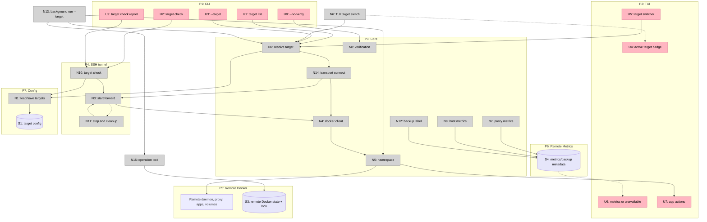

# Remote Targets — Shaping

Status: shape selected, breadboarded, ready to slice
Selected shape: **A — Controller-driven Docker over SSH, transport-abstracted**
Related: [`slices.md`](slices.md) · [`../oma-fork-plan.md`](../oma-fork-plan.md)

## Frame

### Source

Oma users install the tool on their own computer and then need to deploy apps to another machine: a home server, a second computer, or a cloud VPS. The existing catalog and deploy engine are single-host and read the local Docker daemon.

### Problem

- Oma has no target abstraction. Every command uses the local Docker socket.
- Deploying to another machine currently means SSHing into it and running Oma there.
- The dashboard, metrics, backups, and background service all assume the controller is the target.
- Copying a local socket reference or `DOCKER_HOST` works for deploys but leaves host metrics, proxy metrics, verification, backups, and automation ambiguous.

### Outcome

One local Oma binary can deploy to and manage a local machine, another home machine, or a cloud VPS. Remote targets require Docker and SSH, not a remote Oma installation. The selected target is visible everywhere, state stays on the target, and local-only telemetry is never presented as if it came from the remote host. Operational limits such as controller-side backups and unattended updates are explicit.

## Requirements

| ID | Requirement | Status |
| --- | --- | --- |
| R0 | Control a local or remote Docker host from one Oma binary | Core goal |
| R1 | Support another home machine and a cloud VPS as targets | Core goal |
| R2 | Keep the local target as the default; existing local behavior is unchanged | Must-have |
| R3 | Persist target definitions and select a target per command or TUI session | Must-have |
| R4 | Connect over SSH; do not require exposing the Docker TCP port | Must-have |
| R5 | Require only Docker on the target; no Oma binary or remote service | Must-have |
| R6 | Existing operations work remotely: list, deploy, start/stop, update, logs, exec, backup/restore, remove, settings | Must-have |
| R7 | All app and proxy state stays on the target Docker host; switching targets switches state | Must-have |
| R8 | Report clear errors for SSH host-key/auth failures, missing Docker, stopped Docker, and socket permission denial | Must-have |
| R9 | Host CPU/memory/disk data must come from the target or be explicitly marked unavailable; never show controller values | Must-have |
| R10 | Proxy request metrics must come from the target proxy | Must-have |
| R11 | HTTP verification must be optional for remote targets and must not delete app data on failure | Must-have |
| R12 | Backup destination ownership must be explicit; the operator must know whether a backup is on the controller or the target | Must-have |
| R13 | Background update/backup behavior must be explicit per target; no silent assumption that a sleeping controller updates a VPS | Must-have |
| R14 | Provide target add/list/remove commands and a target selector on ordinary commands | Should-have |
| R15 | Provide a TUI target switcher and show the active target in the dashboard | Should-have |
| R16 | Inherit the user's SSH config, agent, identity files, known hosts, and port | Should-have |
| R17 | Reconnect transient SSH failures and fail fast on permanent errors | Should-have |
| R18 | Provide a target connectivity/permission check | Should-have |
| R19 | Provide provisioning guidance for Docker, docker-group membership, DNS, and firewall ports | Nice-to-have |
| R20 | Remote Oma agent/API mode | Out |
| R21 | Fleet scheduling or multi-host placement | Out |
| R22 | Docker TCP/TLS transport and certificate management | Out |
| R23 | Windows controller support | Out |
| R24 | Do not store SSH passwords or private keys in Oma config | Must-have |
| R25 | Multiple targets may use namespaces without colliding | Must-have |
| R26 | Tunnels and temporary sockets are cleaned up on exit and cancellation | Should-have |
| R27 | Cancelling an operation closes its tunnel and child process | Must-have |
| R28 | Target transport is an interface; local, SSH, and future agent implementations do not change command or TUI behavior | Must-have |
| R29 | A target-local background runner can be added without changing app or state formats | Should-have |
| R30 | Interactive and background operations coordinate through a shared lock to avoid concurrent deploy/backup work | Must-have |

Out-of-scope rows are not scored in the fit check.

## Shapes

### A: Controller-driven Docker over SSH (selected)

The controller runs OpenSSH with a local streamlocal forward to the remote Docker unix socket. Oma points its existing Docker client at that local socket. State remains on the remote daemon.

| Part | Mechanism |
| --- | --- |
| **A1** | Target config load/save with default target and per-target namespace |
| **A2** | Target resolver for `--target`, `OMA_TARGET`, and config default |
| **A3** | OpenSSH tunnel supervisor: local socket, readiness, reconnect, cleanup |
| **A4** | Docker client injection into namespace construction |
| **A5** | CLI and TUI target selection and active-target display |
| **A6** | Target-aware proxy metrics via a forwarded metrics port |
| **A7** | Target-aware host metrics via SSH commands, with explicit unavailable fallback |
| **A8** | Verification policy: skippable and non-destructive |
| **A9** | Backup and background automation semantics per target |
| **A10** | Target check, tests, and operator documentation |

### B: Go SSH client dialer

Use a Go SSH library to dial the remote Docker unix socket directly and pass the connection to the Docker client.

| Part | Mechanism |
| --- | --- |
| **B1** | Target config and resolver |
| **B2** | SSH client with agent, identity, known-hosts, and config handling |
| **B3** | Docker client dialer over the SSH connection |
| **B4** | Same selection, metrics, verification, and automation work as A |

### C: Remote Oma agent

Install Oma on the target and expose a local API over SSH or a private network.

| Part | Mechanism |
| --- | --- |
| **C1** | Remote Oma binary and background service |
| **C2** | Authenticated control API |
| **C3** | Client-side target and API transport |
| **C4** | Server-side metrics, backups, and automation |

### D: Docker TCP with TLS

Connect directly to a remote Docker daemon over TCP with mutual TLS.

| Part | Mechanism |
| --- | --- |
| **D1** | Target config with Docker host and certificate paths |
| **D2** | TLS certificate generation/distribution |
| **D3** | Remote firewall exposure for the Docker port |
| **D4** | Same selection, metrics, verification, and automation work as A |

## Fit Check

| Req | Requirement | Status | A | B | C | D |
| --- | --- | --- | --- | --- | --- | --- |
| R0 | Control a local or remote Docker host from one Oma binary | Core goal | ✅ | ✅ | ✅ | ✅ |
| R1 | Support another home machine and a cloud VPS as targets | Core goal | ✅ | ✅ | ✅ | ✅ |
| R2 | Keep the local target as the default; existing local behavior is unchanged | Must-have | ✅ | ✅ | ✅ | ✅ |
| R3 | Persist target definitions and select a target per command or TUI session | Must-have | ✅ | ✅ | ✅ | ✅ |
| R4 | Connect over SSH; do not require exposing the Docker TCP port | Must-have | ✅ | ✅ | ✅ | ❌ |
| R5 | Require only Docker on the target; no Oma binary or remote service | Must-have | ✅ | ✅ | ❌ | ✅ |
| R6 | Existing operations work remotely: list, deploy, start/stop, update, logs, exec, backup/restore, remove, settings | Must-have | ✅ | ✅ | ✅ | ✅ |
| R7 | All app and proxy state stays on the target Docker host; switching targets switches state | Must-have | ✅ | ✅ | ✅ | ✅ |
| R8 | Report clear errors for SSH host-key/auth failures, missing Docker, stopped Docker, and socket permission denial | Must-have | ✅ | ✅ | ✅ | ✅ |
| R9 | Host CPU/memory/disk data must come from the target or be explicitly marked unavailable; never show controller values | Must-have | ✅ | ✅ | ✅ | ✅ |
| R10 | Proxy request metrics must come from the target proxy | Must-have | ✅ | ✅ | ✅ | ✅ |
| R11 | HTTP verification must be optional for remote targets and must not delete app data on failure | Must-have | ✅ | ✅ | ✅ | ✅ |
| R12 | Backup destination ownership must be explicit | Must-have | ✅ | ✅ | ✅ | ✅ |
| R13 | Background update/backup behavior must be explicit per target | Must-have | ✅ | ✅ | ✅ | ✅ |
| R14 | Target add/list/remove commands and a target selector | Should-have | ✅ | ✅ | ✅ | ✅ |
| R15 | TUI target switcher and active-target dashboard display | Should-have | ✅ | ✅ | ✅ | ✅ |
| R16 | Inherit SSH config, agent, identity files, known hosts, and port | Should-have | ✅ | ✅ | ❌ | ❌ |
| R17 | Reconnect transient SSH failures and fail fast on permanent errors | Should-have | ✅ | ✅ | ✅ | ✅ |
| R18 | Target connectivity/permission check | Should-have | ✅ | ✅ | ✅ | ✅ |
| R19 | Provisioning guidance for Docker, groups, DNS, and firewall | Nice-to-have | ✅ | ✅ | ✅ | ✅ |
| R24 | Do not store SSH passwords or private keys in Oma config | Must-have | ✅ | ✅ | ✅ | ❌ |
| R25 | Multiple targets may use namespaces without colliding | Must-have | ✅ | ✅ | ✅ | ✅ |
| R26 | Tunnels and temporary sockets are cleaned up | Should-have | ✅ | ✅ | ✅ | ✅ |
| R27 | Cancelling an operation closes its tunnel and child process | Must-have | ✅ | ✅ | ✅ | ✅ |
| R28 | Target transport is an interface; local, SSH, and future agent implementations do not change command or TUI behavior | Must-have | ✅ | ✅ | ✅ | ✅ |
| R29 | A target-local background runner can be added without changing app or state formats | Should-have | ✅ | ✅ | ✅ | ✅ |
| R30 | Interactive and background operations coordinate through a shared lock to avoid concurrent deploy/backup work | Must-have | ✅ | ✅ | ✅ | ✅ |

**Notes**

- C fails R5: it requires Oma and a service on the target.
- D fails R4 and R24: it exposes Docker over TCP and moves certificate/key handling into Oma.
- B passes the requirements but reimplements SSH config, agent, identity, and known-hosts handling that OpenSSH already provides. A is selected on parts and operational risk, not on a fit failure.

## Selected Shape: A

### Resolved decisions

| Decision | Selected behavior |
| --- | --- |
| Transport | OpenSSH streamlocal forwarding from a short local socket to the remote Docker socket |
| SSH auth | User's SSH config, agent, identity files, and known-hosts; no secrets in Oma config |
| Target config | `~/.config/oma/config.yaml`, `targets` map plus `default`; per-target namespace |
| Local target | Remains default; no tunnel and no behavior change |
| Metrics | Proxy metrics through a forwarded port; host metrics over SSH where supported, otherwise explicitly unavailable |
| Verification | `--no-verify` on deploy/apply paths; failures remove the deployment but not the data volume |
| Backups | Controller-side by default and labeled as such; remote-side backups require a separate decision |
| Automation | Controller-driven `background run --target`; remote agent is deferred |
| Provisioning | `target add` stores the target, `target check` is read-only, and `target setup` is the explicit mutating path. Setup can install Docker and grant socket access on supported Linux hosts; manual setup remains first-class. |

### Parts

| Part | Mechanism | Flag |
| --- | --- | :---: |
| **A1** | Target config: name, SSH destination, Docker socket, namespace; local target | |
| **A2** | Resolver for `--target`, `OMA_TARGET`, and config default; clear unknown-target errors | |
| **A3** | Tunnel supervisor: OpenSSH process, short local socket, readiness probe, reconnect, cleanup | |
| **A4** | Docker client injection and namespace construction | |
| **A5** | CLI/TUI selection and active target display | |
| **A6** | Proxy metrics forward and target-aware metrics reader | |
| **A7** | Host metrics over SSH with unavailable fallback | |
| **A8** | Verification skip and non-destructive failure handling | |
| **A9** | Backup/automation semantics and UI labels | |
| **A10** | Target check, tests, and operator docs | |
| **A11** | Transport interface: connect returns a Docker client plus cleanup; local, SSH, and future agent transports implement it | |
| **A12** | Operation lock in shared Docker state; interactive and background work acquire it before deploy/update/backup | |

No flagged unknowns remain for the selected shape.

### Extensibility seams

The selected shape is not just a one-off SSH path. Two seams keep the recommended follow-ons cheap:

**Transport seam**

- Every command and TUI screen depends on a target transport contract, not on SSH.
- The local transport returns the existing Docker client.
- The SSH transport starts a tunnel and returns a Docker client bound to the local socket.
- A future agent transport can return a Docker client connected to the agent's scoped Docker proxy, or a higher-level control client behind the same target boundary.
- Target metadata (name, source, capabilities) is separate from the connection mechanism.

**Background-runner seam**

- The background scheduler accepts a target; it does not assume the controller is the Docker host.
- Phase 3 runs it on the controller with `background run --target`.
- A future target-local runner can run the same update/backup jobs against local Docker.
- Both paths share Docker state and acquire the same operation lock, so a controller deploy and a target-local backup cannot race.
- Backup ownership remains explicit: controller-side in Phase 3, target-side for a future runner.

## Breadboard

### Places

| # | Place | Description |
| --- | --- | --- |
| P1 | CLI | Target management and target-scoped commands |
| P2 | TUI | Target switcher, dashboard header, and app operations |
| P3 | Core | Target resolution, Docker client, namespace |
| P4 | SSH Tunnel | Local socket and OpenSSH child process |
| P5 | Remote Docker | Remote daemon, proxy, apps, volumes |
| P6 | Remote Metrics | Proxy metrics and host metrics |
| P7 | Config | Target definitions on the controller |

### UI Affordances

| # | Place | Component | Affordance | Control | Wires Out | Returns To |
| --- | --- | --- | --- | --- | --- | --- |
| U1 | P1 | `oma target list` | Target table with default marker | invoke | → N2 | — |
| U2 | P1 | `oma target check` | Connection and permission report | invoke | → N10 | — |
| U3 | P1 | Root command | `--target` selector | invoke | → N2 | — |
| U4 | P2 | Dashboard header | Active target badge | render | — | → N6 |
| U5 | P2 | Target switcher | Target list | click | → N6 | — |
| U6 | P2 | Dashboard | Remote host metrics or unavailable label | render | — | → N9 |
| U7 | P2 | App screens | Existing logs/exec/settings actions against selected target | click | → N5 | — |
| U8 | P1 | Deploy/apply | `--no-verify` flag | invoke | → N8 | — |
| U9 | P1 | `oma target check` | Provisioning readiness report | invoke | → N10 | — |

### Code Affordances

| # | Place | Component | Affordance | Control | Wires Out | Returns To |
| --- | --- | --- | --- | --- | --- | --- |
| N1 | P7 | target config | `Load()` / `Save()` | call | → S1 | → N2 |
| N2 | P3 | target resolver | `Resolve(name)` with flag/env/default | call | → N14 | → N1 |
| N3 | P4 | tunnel | `Start()` OpenSSH forward | call | → S2, N4 | → N2 |
| N4 | P3 | docker | Create client for local socket or local daemon | call | → N5 | → N2 |
| N5 | P3 | namespace | Construct namespace with injected client | call | → P5 | → N2 |
| N6 | P2 | TUI | Select target and rebuild app state | call | → N2 | → U4, U6 |
| N7 | P3 | metrics | Proxy metrics through forwarded port | call | → S4 | → U6 |
| N8 | P3 | verification | Skip or perform non-destructive verification | call | → P5 | → U8 |
| N9 | P3 | system | Host metrics over SSH or unavailable result | call | → P6 | → U6 |
| N10 | P4 | target check | Probe SSH, Docker, socket, and ports | call | → N1, N3 | → U2 |
| N11 | P4 | tunnel | Stop process and remove socket on cancellation | call | → S2 | → N3 |
| N12 | P3 | backup | Label backup destination as controller-side | call | → S4 | → U7 |
| N13 | P3 | background | Run scheduled update/backup checks against the selected target | call | → N2, N5, N15 | → U7 |
| N14 | P3 | transport | `Connect(ctx)` returns a Docker client and cleanup; local, SSH, and future agent transports implement it | call | → N3, N4 | → N2 |
| N15 | P3 | operation lock | Acquire/release the shared lock before deploy, update, or backup | call | → S3 | → N5, N13 |

### Data Stores

| # | Store | Description |
| --- | --- | --- |
| S1 | Target config | Target names, SSH destinations, sockets, namespaces, default |
| S2 | Local socket | Temporary streamlocal socket for the SSH forward |
| S3 | Remote Docker state | App labels, proxy volume, app volumes, operation lock |
| S4 | Metrics/backup metadata | Remote metrics and controller-side backup paths |

### Wiring



**Legend**

- Pink nodes are UI affordances.
- Grey nodes are code affordances.
- Purple nodes are data stores.
- Solid arrows are control flow.
- Dashed arrows are data flow.

## Setup Paths

### Manual setup

The default path is bring-your-own-host. The operator prepares SSH access and Docker, then Oma only reads and connects.

```sh
# On the target, as a sudo-capable user
curl -fsSL https://get.docker.com | sudo sh
sudo usermod -aG docker deploy

# On the controller
oma target add vps --ssh deploy@vps --docker-socket /var/run/docker.sock
oma target check vps
oma --target vps list
```

Requirements: SSH key/agent access, Docker installed, and the SSH user allowed to read the Docker socket. With a non-root user, that means docker-group membership and a fresh SSH session after the group change. Root SSH works but is discouraged.

### Guided setup

`oma target setup <name>` is the optional, explicit bootstrap path, roughly the Oma equivalent of `kamal server bootstrap`:

1. Probe SSH with batch mode and the user's existing config/agent.
2. Detect the remote OS and architecture; bootstrap is supported on Linux only.
3. Check `docker info` as the SSH user.
4. If Docker is missing, offer to install it with `get.docker.com` (or print the distro commands if declined).
5. If the socket is permission-denied, offer `usermod -aG docker <user>`.
6. Reconnect with a fresh SSH session so group membership applies.
7. Verify Docker, socket access, and the ability to pull the proxy image.
8. Report DNS and firewall readiness for ports 80/443; do not change them automatically.
9. Save the target only after verification succeeds.

Safeguards:

- Setup requires `--yes` or an interactive confirmation before any remote mutation.
- Setup is idempotent; re-running it only verifies what already exists.
- Setup never stores passwords, private keys, or tokens.
- Setup does not create a remote Oma user, binary, or service.
- Without sudo/root, setup fails with exact copy-paste commands.
- Rootless Docker requires an explicit socket path.

This is deliberately narrower than `kamal setup`: Oma does not deploy an app as part of setup, and no remote Oma process is installed. The bootstrap is closer to `kamal server bootstrap`, plus the socket-permission check Oma requires.

## Operational Semantics

- **Local target:** `local` uses the Docker client as it exists today; no SSH process, no local socket.
- **Remote target:** Oma starts one tunnel per target session, waits for the local socket, constructs the Docker client, and tears the tunnel down on exit or cancellation.
- **SSH failure:** invalid host key, auth failure, unreachable host, and missing `ssh` binary produce distinct errors before any Docker call.
- **Docker failure:** Docker absent, stopped, or permission-denied on the remote host produces an actionable error.
- **Metrics:** remote proxy metrics are read from the target. Host metrics use SSH commands; unsupported platforms show "unavailable" rather than local values.
- **Verification:** remote deploy/apply can use `--no-verify`. A failed verification removes the new deployment but preserves the data volume.
- **Backups:** the backup path is a controller path by default and the UI labels it accordingly. A remote path is not implied.
- **Automation:** `background run --target` runs on the controller. If the controller is offline, remote apps are not updated or backed up. A remote agent is future work.

## Notes for Implementation

- Use short local socket paths because macOS limits unix socket path length.
- Never store a password or private key in the target config.
- Keep the local target path as a separate code path so existing behavior cannot regress.
- Treat target selection as part of namespace construction, not as a global mutable variable.
- Surface the active target in every screen that shows host metrics or backup paths.
