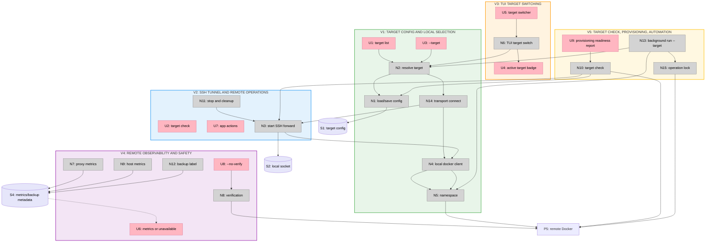

# Remote Targets — Slices

Selected shape: **A — Controller-driven Docker over SSH, transport-abstracted**
Ground truth for R, fit check, parts, and breadboard: [`shaping.md`](shaping.md)
Related: [`../../specs/remote-targets.md`](../../specs/remote-targets.md) · [`../oma-fork-plan.md`](../oma-fork-plan.md)

Each slice is vertical and ends with a demo-able operator surface. Slices may land as separate commits or pull requests, but each keeps the build and tests green.

## Slice Overview

| # | Slice | Mechanism | Demo |
| --- | --- | --- | --- |
| V1 | Target config and local selection | Config file, resolver, `target` CLI, `--target`, local default | `oma target list` and `oma --target local list` behave as today |
| V2 | SSH tunnel and remote operations | OpenSSH forward, Docker client injection, remote namespace, connection probe | Deploy and manage an app on a VPS |
| V3 | TUI target switching | Switcher, active-target badge, rebuilt app state | Switch from laptop to VPS in the dashboard |
| V4 | Remote observability and safety | Proxy metrics, host metrics or unavailable, `--no-verify`, backup labels | Remote dashboard and a safe verification failure |
| V5 | Target setup, provisioning, automation | Explicit `target setup`, provisioning readiness, `background run --target` | Bootstrap a VPS, then run scheduled updates from the controller |

V1 is the prerequisite for V2. V3 depends on V2. V4 depends on V2. V5 depends on V2 and V4.

## Sliced Breadboard

## V1: Target Config and Local Selection

Status: complete.

**Goal:** Targets are data, and the local target remains the default.

**Affordances:** U1, U3, N1, N2, N4, N5, N14

**Demo:** `oma target list` shows `local` as the default. `oma --target local list` returns the same apps as `oma list`. A missing target name produces a clear error.

**Acceptance**

- Config is loaded from `~/.config/oma/config.yaml` or `$XDG_CONFIG_HOME/oma/config.yaml`.
- A missing config creates an implicit `local` target without writing a file.
- `target add`, `target list`, and `target remove` work for named targets.
- `--target` selects a target; `OMA_TARGET` is the fallback; the config default is last.
- Unknown target names fail before any Docker call.
- The local target uses the existing Docker client path and does not start SSH.
- Target resolution returns a transport implementation; the local implementation satisfies the same contract the future SSH and agent transports use.
- Command construction depends on the transport contract, not on a concrete SSH process.
- Removing the default target is rejected or reassigns the default explicitly.
- Unit and CLI tests pass.

**Out of scope:** SSH tunnels, TUI switching, remote metrics.

## V2: SSH Tunnel and Remote Operations

Status: complete.

**Goal:** A remote target behaves like the local target through the existing Docker API.

**Affordances:** U2, U7, N3, N4, N11

**Demo:** Add a VPS target, run `oma target check`, deploy an app with `oma --target vps deploy ...`, then list, stop, start, read logs, exec, back up, restore, and remove it.

**Acceptance**

- Target creation stores an SSH destination, Docker socket, and namespace.
- The tunnel starts OpenSSH with a short local socket and waits for readiness.
- The SSH implementation satisfies the same transport contract as the local target; commands and TUI code are unchanged.
- Docker operations use the injected remote client; no local Docker state is read.
- Deploy, list, start, stop, update, logs, exec, backup, restore, remove, and settings work remotely.
- App and proxy state appears only on the remote daemon.
- SSH host-key/auth failures, missing Docker, stopped Docker, and socket permission denial produce distinct errors.
- Exiting or cancelling closes the SSH process and removes the local socket.
- A connection probe verifies SSH, Docker, and socket access; provisioning readiness is added in V5.
- Local target behavior is unchanged.
- Unit, CLI, and integration tests pass, including a real SSH target when available.

**Out of scope:** TUI switching, metrics, automation.

## V3: TUI Target Switching

**Goal:** The dashboard clearly belongs to one target and can switch targets.

**Affordances:** U4, U5, N6

**Demo:** Start Oma, switch from laptop to VPS, see the VPS apps and active-target badge, perform an action, then switch back.

**Acceptance**

- The dashboard header shows the active target name.
- The target switcher lists configured targets and the default.
- Switching targets closes the previous tunnel and rebuilds namespace, apps, metrics, and event subscriptions.
- An SSH failure during switching keeps the previous target active and shows an error.
- Local target switching has no tunnel overhead.
- TUI tests cover the header, switcher, and failed switch.
- The local target remains the default at startup.

**Out of scope:** Fleet dashboards, simultaneous multi-target views.

## V4: Remote Observability and Safety

**Goal:** Remote telemetry comes from the target or is visibly unavailable, and a failed check cannot destroy data.

**Affordances:** U6, U8, N7, N8, N9, N12

**Demo:** Open the remote dashboard and see proxy request metrics plus target CPU/memory/disk (or an explicit unavailable label). Run a deploy with `--no-verify` and confirm the app stays. Induce a verification failure and confirm the data volume remains.

**Acceptance**

- Proxy metrics come from the target proxy, not the controller.
- Host CPU/memory/disk come from the target through SSH or show "unavailable"; controller values are never displayed for a remote target.
- `--no-verify` skips verification for deploy and apply.
- A failed verification removes the new deployment but leaves the data volume intact.
- Backup paths are labeled as controller-side when the target is remote.
- Metrics and backup labels update immediately after a target switch.
- Tests cover remote metrics, unavailable fallback, skipped verification, and non-destructive failure.

**Out of scope:** Remote-side backup storage, remote agent telemetry.

## V5: Target Setup, Provisioning, Automation

**Goal:** An operator can bootstrap a target explicitly, and understand what background automation does when the controller is offline.

**Affordances:** U9, N10, N13, N15

**Demo:** `oma target setup vps --yes` installs Docker if needed, fixes docker-group access, reconnects, verifies the socket, and reports DNS/firewall readiness. `oma --target vps background run` updates and backs up remote apps while the controller runs; the UI/docs state that a sleeping controller stops automation.

**Acceptance**

- `target add` stores a target without mutating the remote host.
- `target check` is read-only and preserves the V2 SSH, Docker, and socket results.
- `target setup` is explicit, confirmed, idempotent, and requires no remote Oma installation.
- Setup installs Docker when missing, adds the SSH user to the docker group when permission is denied, and reconnects to verify.
- Setup without sudo/root fails with exact manual commands.
- Setup never stores passwords, private keys, or tokens.
- Setup reports DNS and ports 80/443 readiness without changing firewall or DNS automatically.
- `background run --target` uses the selected target and performs update/backup checks against it.
- Interactive and background operations acquire the shared operation lock before deploy, update, or backup.
- The background runner depends on the target transport, not on a concrete SSH process.
- The background service records the target name and the controller-side backup path.
- The UI/docs state that a stopped controller stops remote automation.
- A remote-agent path and a target-local runner are not implemented, but the transport and runner seams are documented and tested at the interface level.
- Tests cover setup outcomes, check outcomes, background target selection, operation-lock contention, and offline-controller messaging.

**Out of scope:** Remote Oma agent, multi-target scheduling, remote-side backup storage, automatic DNS/firewall changes.

## Slice Grid

|  |  |  |
| :-- | :-- | :-- |
| **V1: Target Config and Local Selection** ✅ COMPLETE  • Target config • Resolver • CLI target commands • Local default  *Demo: `target list` and `--target local`* | **V2: SSH Tunnel and Remote Operations** ✅ COMPLETE  • OpenSSH forward • Docker client injection • Remote CRUD • Connection probe  *Demo: Deploy and manage a VPS app* | **V3: TUI Target Switching** ⏳ PENDING  • Active-target badge • Switcher • State rebuild • Failed-switch handling  *Demo: Switch laptop to VPS* |
| **V4: Remote Observability and Safety** ⏳ PENDING  • Target metrics • Unavailable fallback • `--no-verify` • Non-destructive failure  *Demo: Remote dashboard and safe failure* | **V5: Target Setup and Automation** ⏳ PENDING  • Explicit setup • Provisioning check • Background target • Offline-controller notes  *Demo: Bootstrap a VPS and run backups* | **V6: Deferred Extensions** ⏳ OUT OF SCOPE  • Remote agent transport • Target-local runner • Fleet scheduling • Docker TCP/TLS • Remote-side backups  *Demo: Not part of this phase* |
